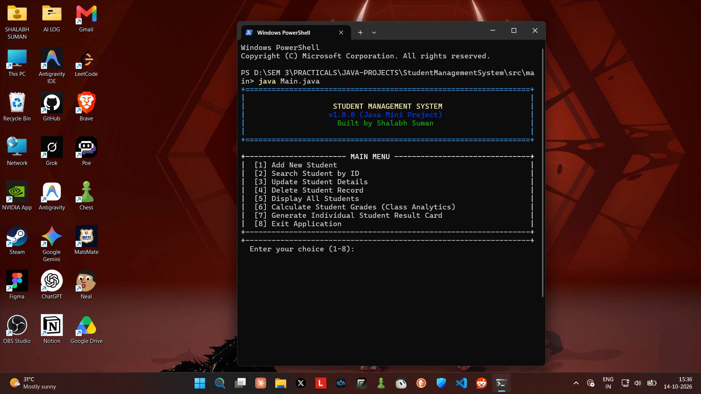

<div align="center">

# 🎓 Student Management System

### A Java Mini Project | Core Java & Object-Oriented Programming

A simple, console-based Student Management System built using Java to manage student records and perform basic academic operations.

<br>

<!-- PROJECT SCREENSHOT: Add your screenshot to the repository's screenshots folder -->


*Project Preview — Student Management System*

<br>


</div>

---

## 📌 About the Project

The **Student Management System** is a Java mini project developed to apply fundamental programming concepts and Object-Oriented Programming (OOP) principles in a practical application.

The project provides basic operations for managing student information, including adding, searching, updating, and deleting student records. It also includes grade calculation and result generation.

This project was developed as part of my academic learning to strengthen my understanding of Core Java.

## ✨ Features

- ➕ **Add Student** — Add new student records.
- 🔍 **Search Student** — Find student details.
- ✏️ **Update Student** — Modify existing student information.
- 🗑️ **Delete Student** — Remove student records.
- 📋 **Display Students** — View student details.
- 📊 **Calculate Grades** — Calculate grades based on student marks.
- 📝 **Generate Results** — Generate student results.

## 🛠️ Java Concepts Used

| Concept | Application |
|---|---|
| Classes & Objects | Represent students and their data |
| Constructors | Initialize student objects |
| Method Overloading | Implement methods with different parameter lists |
| Inheritance | Reuse and extend class functionality |
| Interfaces | Define common method contracts |
| Packages | Organize Java classes |
| Static Members | Maintain class-level data or methods |
| Access Specifiers | Control access to classes and members |

## 💻 Technologies Used

- **Language:** Java
- **Core Concepts:** Object-Oriented Programming (OOP)
- **Development Environment:** VS Code / Any Java-compatible IDE
- **Execution:** Java Terminal / Command Line

## 🚀 Getting Started

Follow these steps to run the project locally.

### Prerequisites

Make sure you have the following installed:

- Java Development Kit (JDK)
- Visual Studio Code or another Java-compatible IDE
- Git (optional, for cloning the repository)

Verify your Java installation:

```bash
java -version
javac -version
```

### Installation

**1. Clone the repository**

```bash
git clone https://github.com/YOUR-USERNAME/YOUR-REPOSITORY.git
```

**2. Open the project folder**

```bash
cd YOUR-REPOSITORY
```

**3. Compile the Java files**

If your project has multiple packages, compile the source files according to your folder structure and package declarations.

For a simple project with a single Java file:

```bash
javac Main.java
```

**4. Run the application**

```bash
java Main
```

> **Note:** Replace `Main.java` and `Main` with your actual entry-point filename and class name. For multi-file projects, compilation and execution commands may differ depending on the package structure.

## 📂 Project Structure

The project may be organized as follows. Update this structure to match your actual repository.

```text
Student-Management-System/
│
├── src/
│   ├── Main.java
│   ├── Student.java
│   └── ...
│
├── screenshots/
│   └── project-preview.png
│
└── README.md
```

## 🎯 Learning Outcomes

Through this project, I practised:

- Applying OOP principles to a practical problem.
- Organizing Java code into classes and packages.
- Working with constructors and overloaded methods.
- Understanding inheritance and interfaces.
- Implementing CRUD operations for student records.
- Improving logical thinking and problem-solving skills.

## 👨‍💻 Developer

**Shalabh Suman**

B.Tech CSE Student | Aspiring Software Developer

- GitHub: [@heyshalabh](https://github.com/heyshalabh)
- LinkedIn: [shalabh-suman](https://www.linkedin.com/in/shalabh-suman/)

## 🙏 Acknowledgement

Special thanks to **[Ma'am's Name]** for teaching us Java and assigning this mini project.

This project provided an opportunity to apply classroom concepts and gain practical programming experience.

## ⭐ Support

If you find this project helpful for learning Java or understanding basic OOP concepts, consider giving this repository a ⭐.

Thanks for visiting! 🚀

---

<div align="center">

**Built with Java by Shalabh Suman 💻**

*Learn • Build • Improve*

</div>